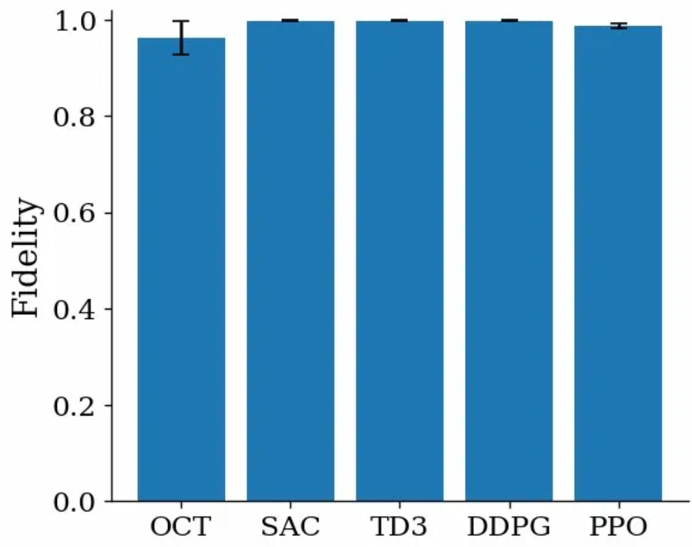
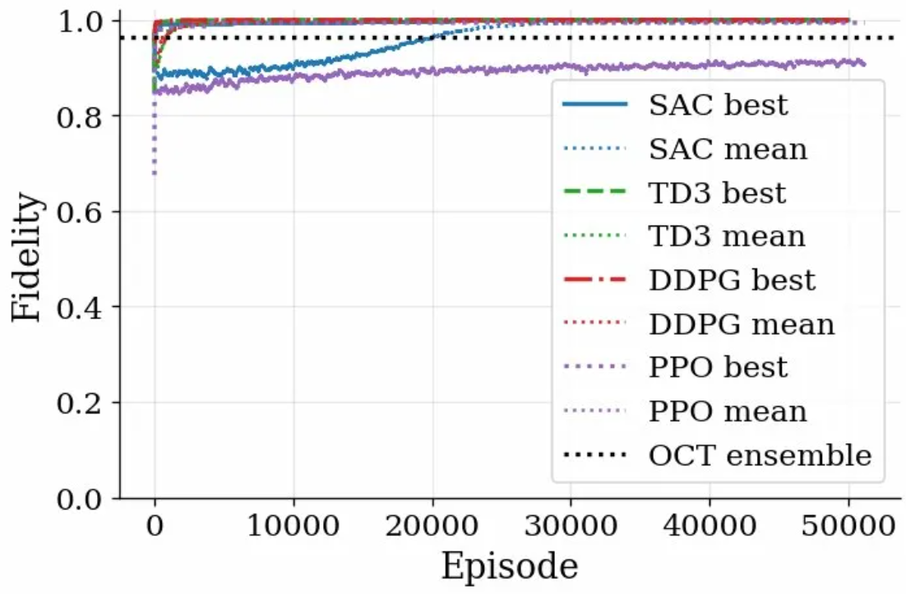

# Quantum gate calibration with reinforcement learning

Automatic calibration of a **CZ** gate on two coupled, noisy superconducting qubits (transmons).
A control pulse is first optimised with optimal control (**GRAPE**), then a deep reinforcement learning agent learns how to correct it when the real parameters of the processor drift away from the model.

Multidisciplinary project by a team of six (ECE Paris, 4th year, 2025-2026), code name CAMSIA.


## The problem

A two-qubit gate is implemented by sending microwave pulses whose shape must be tuned very precisely. Optimal-control methods such as GRAPE give a nearly perfect pulse **on the model**; on hardware, the qubit frequencies and their coupling drift, and the fidelity drops.

The idea of the project: keep GRAPE as the starting point and let an RL agent learn the **residual correction** to apply on the noisy system.

```
Nominal Hamiltonian ──► GRAPE ──► pulses ε₁(t), ε₂(t)
                                        │
                                        ▼
        noisy system (δω₁, δω₂, δg) ──► RL agent: correction Δε ──► fidelity F
                                                ▲                       │
                                                └──── reward F − F_GRAPE
```

## Results

Average gate fidelity over 100 noise realisations (team's final pipeline):

| Method | Mean fidelity | Standard deviation |
|---|---|---|
| GRAPE alone | 0.9629 | 3.4 × 10⁻² |
| GRAPE + SAC | 0.9987 | 7.8 × 10⁻⁴ |
| GRAPE + TD3 | 0.9988 | 8.5 × 10⁻⁴ |
| GRAPE + DDPG | 0.9990 | 8.2 × 10⁻⁴ |
| GRAPE + PPO | 0.9881 | 5.3 × 10⁻³ |

The off-policy agents bring the fidelity back above 0.998 and reduce the spread by a factor of about forty.

| Fidelity over the noisy ensemble | Learning curves |
|---|---|
|  |  |

The scientific poster of the project is in [docs/poster.png](docs/poster.png).

## Physical model

Two transmons modelled as coupled three-level anharmonic oscillators (qutrits):

$$H = \sum_{i=1,2}\left[\omega_i\, a_i^\dagger a_i + \chi_i\, a_i^\dagger a_i^\dagger a_i a_i + \varepsilon_i(t)\,(a_i + a_i^\dagger)\right] + g\,(a_1 + a_1^\dagger)(a_2 + a_2^\dagger)$$

- piecewise-constant pulses (160 segments), propagator obtained by matrix exponentiation;
- target: CZ gate generalised to qutrits; metric: average gate fidelity;
- noise: Gaussian offsets on the frequencies ω₁, ω₂ and on the coupling g.

## Repository layout

```
├── physics_model/
│   ├── qubit_pulse_simulation.py     Qubit driven by a Gaussian pulse (Lindblad master equation)
│   ├── qutrit_pulse_simulation.py    Same study on a three-level transmon, with relaxation and dephasing
│   └── results/                      Population dynamics for several pulse durations
├── reinforcement_learning/
│   ├── agent/
│   │   ├── sac.py                    GRAPE + SAC agent, automatic resume from checkpoint
│   │   ├── td3.py                    GRAPE + TD3 agent
│   │   └── dqn.py                    Discrete-action variant (scale factor applied to the pulse)
│   └── prototypes/                   First versions (December 2025): SAC and TD3 with fidelity logging
├── results/                          Figures from the final pipeline
├── docs/poster.png
└── requirements.txt
```

Each agent script is self-contained: it builds the system, runs GRAPE, creates the Gymnasium environment (`CZResidualBanditEnv`), trains the agent and plots the curves.
The figures in `results/` were produced by the team's final pipeline (four agents, corrections expressed in a discrete cosine basis); the scripts versioned here are the residual SAC, TD3 and DQN agents.

## Usage

```bash
git clone https://github.com/shiva-tilhoo/quantum-gate-calibration-rl.git
cd quantum-gate-calibration-rl
python -m venv .venv && source .venv/bin/activate    # Windows: .venv\Scripts\activate
pip install -r requirements.txt

python physics_model/qubit_pulse_simulation.py       # a few seconds
python reinforcement_learning/agent/sac.py           # GRAPE, then 50,000 episodes
```

Training writes its checkpoints to `checkpoints_<algo>/` and resumes where it stopped when relaunched. It is slow on CPU: a GPU or Google Colab is recommended.

## Team and roles

Al-amine Maouloud, Ilyes Boukerma, Camélia Fixaris, Amine Zaïdi, Mawlesan Thayaparan, Shiva Tilhoo.

The team was split into two groups, physical modelling and learning. My part of the work:

- building the two-transmon simulator with QuTiP, from the Hamiltonian to the fidelity metric, and validating GRAPE on the nominal system;
- integrating the GRAPE → RL pipeline and defining the Gymnasium interface between the two groups;
- taking part in diagnosing why agents trained from scratch plateaued (action space too large), which led to the residual approach initialised with GRAPE;
- creating and structuring this repository.

## References

- N. Khaneja et al., *Optimal control of coupled spin dynamics: design of NMR pulse sequences by gradient ascent algorithms*, J. Magn. Reson., 2005.
- H. N. Nguyen et al., *Reinforcement learning pulses for transmon qubit entangling gates*, 2024.
- M. Kononenko et al., *Characterization of control in a superconducting qutrit using randomized benchmarking*, 2021.

## License

[CC0 1.0](LICENSE).
